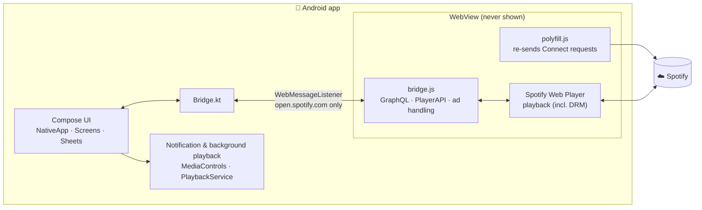

<div align="center">

# spotfy

**The Spotify Web Player, with the feel of the official app.**

An unofficial Android app powered by a native UI and the Web Player's playback engine

[](https://github.com/ninjin0802/spotfy/releases/latest)
[](https://github.com/ninjin0802/spotfy/actions/workflows/ci.yml)


[](LICENSE)

### [⬇ Download the latest APK](https://github.com/ninjin0802/spotfy/releases/latest)

[日本語](README.md) ・ **English**

</div>

> [!IMPORTANT]
> This is an **unofficial** personal project. It is not affiliated with, endorsed by, or sponsored by Spotify AB.
> "Spotify" and its logo are trademarks of Spotify AB. Use at your own risk.

> [!NOTE]
> The app's own UI is currently available in **Japanese only**. Content provided by Spotify (track names, home shelves, etc.) follows your account and device language.

<br>

## ✨ Highlights

<table>
<tr>
<td width="50%" valign="top">

### 📱 Feels like the official app
Every screen is a native UI built with Jetpack Compose.
Home, Search, Library and the player look and behave the way a phone app should.

</td>
<td width="50%" valign="top">

### ⏩ Ads end in 2–3 seconds
During an ad the app mutes it and plays it to the end at 16× speed.
A 30-second ad is over almost instantly (toggle in Settings).

</td>
</tr>
<tr>
<td width="50%" valign="top">

### 🔐 Privacy by design
You sign in on Spotify's own login page. The app talks to Spotify directly, with no relay server,
and never saves tracks to your device.

</td>
<td width="50%" valign="top">

### 🛟 Knows when it breaks
If a Spotify update breaks a feature, Settings tells you which one.
Share a debug log with a single tap.

</td>
</tr>
</table>

<br>

## 🎵 Features

| | |
|:--|:--|
| 🏠 **Home** | All / Music / Podcasts (with Following), shortcuts, shelves, new releases |
| 🔎 **Search** | Genre tiles, recent searches, live results with type filters |
| 📚 **Library** | Filters, sorting, list / grid, pins, search in library, create playlists and folders |
| 🎧 **Player** | Mini and full-screen players tinted by the artwork, lyrics, About the artist, Next up |
| 📋 **Queue** | Drag to reorder, remove, shuffle / repeat, sleep timer |
| 🔀 **Playback** | Gapless playback, crossfade (1–12 s), background playback |
| ⏩ **Ad handling** | Disables the Web Player's ad managers, then mutes ads and plays them at 16× |
| 📡 **Cast** | Spotify Connect to PCs, speakers and TVs; switch between phone speaker and Bluetooth |
| 👥 **Social** | Edit your profile, followers / following, follow other users |
| 🎨 **Theme** | 5 accent colors, AMOLED black |
| 🎚 **Audio quality** | Separate settings for Wi-Fi and mobile data (free plan: up to AAC 128 kbps) |

<br>

## 📦 Install

1. Download `spotfy-*.apk` from [**Releases**](https://github.com/ninjin0802/spotfy/releases/latest)
2. Open it on your device to install (the first time you need to allow "unknown apps")
3. Open the app and sign in with your Spotify account

> [!NOTE]
> Works with free accounts. Premium / official-app-only features such as lossless audio, Jam and downloads are not available.

<details>
<summary><b>Troubleshooting</b></summary>

<br>

| Symptom | What to do |
|:--|:--|
| "Spotify に接続できません" (can't connect to Spotify) | Check your connection. The app reloads automatically once you're back online |
| "Android System WebView が必要です" (WebView required) | Update Android System WebView from the Play Store |
| "⚠ 一部の機能が使えません" (some features unavailable) in Settings | Probably caused by a Spotify update. Tap it to share a debug log |
| Anything else | Settings → "デバッグログを共有" (Share debug log) helps track it down |

</details>

<br>

## 🧩 How it works

The app draws its own screens, while data and playback are handled by [open.spotify.com](https://open.spotify.com) (the Spotify Web Player) running in the background.
It calls the same endpoints the Web Player itself uses (GraphQL, etc.), so it runs lighter than v1, which restyled the web page.



- Android WebView adds an `X-Requested-With` header to every request, which stops Spotify Connect playback commands from being delivered. The app re-sends only those playback requests itself
- Search and history call the Web Player's own GraphQL loader and render the results natively (the same idea as [Myspoti](https://github.com/kota-zo/myspoti); no code is copied)

<br>

## 🛠 Development

```bash
./gradlew assembleDebug      # debug build
./gradlew assembleRelease    # release build (needs a signing key)
scripts/smoke-test.sh        # check startup flows on an emulator
```

| Item | Version |
|:--|:--|
| minSdk / targetSdk | 26 / 36 |
| Android Gradle Plugin | 8.13 |
| Kotlin | 2.2 |
| Dependencies | `androidx.webkit`, Jetpack Compose, Coil, Palette |

<details>
<summary><b>Signing key</b></summary>

<br>

The release signing key is read from `~/.config/spotfy/keystore.properties` (outside the repository).

```properties
storeFile=/path/to/release.jks
storePassword=...
keyAlias=...
keyPassword=...
```

</details>

<details>
<summary><b>Releasing</b></summary>

<br>

The version lives only in the `VERSION` file at the repository root (`major.minor.patch`).
`versionName` is that value and `versionCode` is derived from it (`2.1.0` → `20100`), so there is nothing to edit by hand.

1. Bump `VERSION` (patch for fixes, minor for features)
2. Add a `## <version>` section at the top of [`CHANGELOG.md`](CHANGELOG.md)
3. Open a PR from your branch and merge it into main once CI passes
4. Run `scripts/release.sh` on the latest main
   - Builds a signed APK, pushes a `v<version>` tag and publishes the APK with that changelog section to GitHub Releases
   - Stops if the tag already exists, there are uncommitted changes, HEAD is not the latest main, or the changelog section is missing
   - Runs `scripts/smoke-test.sh` before tagging and stops on failure (`SKIP_SMOKE=1` only when in a hurry)

</details>

<details>
<summary><b>CI and smoke tests</b></summary>

<br>

GitHub Actions ([`.github/workflows/ci.yml`](.github/workflows/ci.yml)) runs on every PR and every push to main. Changes reach main only through PRs that pass CI.

- Syntax checks for `bridge.js`, `polyfill.js` and the scripts
- A build with the release configuration (signed with the debug key, since CI has no signing key)
- Smoke tests on emulators (Android 15 and Android 8)

What `scripts/smoke-test.sh` checks:

- First launch shows the login page
- Without a connection, "Spotify に接続できません" appears, and the login page comes back once online
- On a device without a usable WebView (the plain Android 8 image), the app shows the update notice instead of crashing

Locally, choose AVDs with `SMOKE_AVD` (default `keyboard-test`) and `SMOKE_AVD_OLD` (default `keyboard-test-api26`).
To use an emulator that is already running, set `SMOKE_SERIAL` and `SMOKE_CASES` (`modern` / `old`).

</details>

<details>
<summary><b>When a Spotify update breaks something</b></summary>

<br>

The app relies on internals of the Web Player, so a Spotify update can break some features.

- Shortly after launch the app checks that the internals it uses are present. If any are missing, "⚠ 一部の機能が使えません" appears at the top of Settings
- The health check result (`bridge.health`), failed calls (`bridge.error`, `bridge.timeout`), ad handling and page load errors are recorded in the debug log
- Ask users to send it via Settings → "デバッグログを共有", or pull it over adb:

```bash
adb shell am start -n com.ninjin.spotifyweb/.MainActivity --ez dumpDebugLog true
adb logcat -s spotfy-debug
```

</details>

<br>

## 📄 License

[MIT](LICENSE) · See [CHANGELOG.md](CHANGELOG.md) for release notes

## ⚠️ Disclaimer

This software is provided as is, without warranty of any kind. It may stop working without notice if Spotify changes its service.
Handling ads this way may violate Spotify's Terms of Use and may affect your account. Please use it in accordance with those terms.
