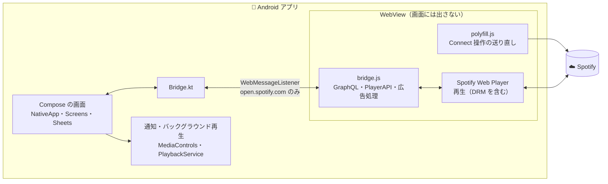

<div align="center">


# spotfy

**Spotify Web Player を、公式アプリのような操作感で。**

ネイティブ UI × Web Player の再生エンジンで動く、非公式の Android アプリ

[](https://github.com/ninjin0802/spotfy/releases/latest)
[](https://github.com/ninjin0802/spotfy/actions/workflows/ci.yml)


[](LICENSE)

### [⬇ 最新の APK をダウンロード](https://github.com/ninjin0802/spotfy/releases/latest)

**日本語** ・ [English](README.en.md)

</div>

> [!IMPORTANT]
> これは **非公式** の個人プロジェクトです。Spotify AB とは一切関係がなく、承認や支援も受けていません。
> 「Spotify」の名称とロゴは Spotify AB の商標です。利用は自己責任でお願いします。

<br>

## ✨ 特長

<table>
<tr>
<td width="50%" valign="top">

### 📱 公式アプリに近い操作感
画面はすべて Jetpack Compose で描いたネイティブ UI。
ホーム・検索・ライブラリ・プレーヤーを、スマホに合った見た目と動きで使えます。

</td>
<td width="50%" valign="top">

### ⏩ 広告は 2〜3 秒で終わる
広告の間はミュートし、16 倍速で最後まで再生。
30 秒の広告がほぼ一瞬で終わります（設定でオン／オフ）。

</td>
</tr>
<tr>
<td width="50%" valign="top">

### 🔐 安心の設計
ログインは Spotify 公式のページ。通信は Spotify と直接で、中継サーバーはありません。
曲を端末に保存することもありません。

</td>
<td width="50%" valign="top">

### 🛟 壊れても気づける
Spotify 側の更新で使えない機能が出ると、設定画面でお知らせ。
デバッグログをワンタップで共有できます。

</td>
</tr>
</table>

<br>

## 🎵 主な機能

| | |
|:--|:--|
| 🏠 **ホーム** | すべて／音楽／ポッドキャスト（フォロー中つき）、ショートカット、棚、最新リリース |
| 🔎 **検索** | ジャンルのタイル、最近の検索、入力に合わせた結果と種類の絞り込み |
| 📚 **ライブラリ** | 絞り込み・並べ替え・リスト／グリッド、ピン、ライブラリ内検索、プレイリスト・フォルダの作成 |
| 🎧 **プレーヤー** | ジャケット色のミニ／全画面プレーヤー、歌詞、アーティストについて、次に再生 |
| 📋 **キュー** | ドラッグで並べ替え、外す、シャッフル・リピート・おやすみタイマー |
| 🔀 **再生** | 途切れないギャップレス再生、2 曲を重ねるクロスフェード（1〜12 秒）、バックグラウンド再生 |
| ⏩ **広告の処理** | 広告機能の停止＋広告中のミュートと 16 倍速 |
| 📡 **キャスト** | Spotify Connect で PC・スピーカー・テレビへ、スピーカー／Bluetooth の切り替え |
| 🧭 **メニュー** | 最近（再生したものを日ごとに）、あなたへのおすすめ新着（フォロー中のリリース・エピソード） |
| 👥 **ソーシャル** | プロフィールの編集、フォロワー／フォロー中、ほかのユーザーのフォロー |
| 🎨 **テーマ** | アクセントカラー 9 色、AMOLED ブラック |
| 🌐 **言語** | 端末の言語に合わせて日本語／英語。設定の「言語」で固定もできる |
| 🔄 **アップデート** | 新しい版が出るとアプリ内でお知らせ。ボタン 1 つでダウンロードしてインストール |
| 🎚 **音質** | Wi-Fi／モバイルデータ通信で別々に設定（無料プランは AAC 128 kbps まで） |

<br>

## 📦 インストール

1. [**Releases**](https://github.com/ninjin0802/spotfy/releases/latest) から `spotfy-*.apk` をダウンロード
2. 端末で開いてインストール（初回は「提供元不明のアプリ」の許可が必要です）
3. アプリを開き、Spotify アカウントでログイン

> [!NOTE]
> 表示は端末の言語に合わせて **日本語・英語** が切り替わります（Android 13 以降は、このアプリだけ言語を変えることもできます）。
>
> 無料アカウントでも使えます。ロスレス音質・Jam・ダウンロードなど、Premium／公式アプリ専用の機能は使えません。

<details>
<summary><b>うまく動かないときは</b></summary>

<br>

| 症状 | 対処 |
|:--|:--|
| 「Spotify に接続できません」と出る | 通信を確認してください。つながると自動で開き直します |
| 「Android System WebView が必要です」と出る | Play ストアで Android System WebView を更新してください |
| 設定に「⚠ 一部の機能が使えません」と出る | Spotify 側の更新が原因かもしれません。その項目を押してデバッグログを共有してください |
| そのほかの不具合 | 設定 →「デバッグログを共有」で送ってもらえると原因を追えます |

</details>

<br>

## 🧩 仕組み

画面はアプリ側で描き、データの取得と再生は、裏で動かす [open.spotify.com](https://open.spotify.com)（Spotify Web Player）に任せています。
Web Player 自身と同じ通信（GraphQL など）を直接呼ぶので、Web のページを組み替えていた v1 より軽く動きます。



- Android WebView はすべての通信に `X-Requested-With` ヘッダーを付けるため、Spotify Connect の再生コマンドが届かなくなります。再生操作の通信だけをアプリから送り直して解決しています
- 検索・履歴は Web Player 自身の GraphQL ローダーを呼び、結果をアプリ側で描画しています（[Myspoti](https://github.com/kota-zo/myspoti) と同じ考え方。コードは流用していません）

<br>

## 🛠 開発

```bash
./gradlew assembleDebug      # デバッグ版
./gradlew assembleRelease    # リリース版（署名鍵が必要）
scripts/smoke-test.sh        # エミュレーターで起動まわりを確認
```

| 項目 | バージョン |
|:--|:--|
| minSdk / targetSdk | 26 / 36 |
| Android Gradle Plugin | 8.13 |
| Kotlin | 2.2 |
| 依存ライブラリ | `androidx.webkit`、Jetpack Compose、Coil、Palette |

<details>
<summary><b>署名鍵</b></summary>

<br>

リリース版の署名鍵は `~/.config/spotfy/keystore.properties`（リポジトリ外）から読み込みます。

```properties
storeFile=/path/to/release.jks
storePassword=...
keyAlias=...
keyPassword=...
```

</details>

<details>
<summary><b>リリースの手順</b></summary>

<br>

版の番号はリポジトリ直下の `VERSION`（`メジャー.マイナー.パッチ`）だけで管理します。
`versionName` はこの値、`versionCode` はここから計算（`2.1.0` → `20100`）するので、手で書き換える場所はありません。

1. `VERSION` を上げる（不具合の修正はパッチ、機能追加はマイナー）
2. [`CHANGELOG.md`](CHANGELOG.md) の先頭に `## <版>` の節を書く
3. 作業ブランチで PR を作り、CI が通ったら main にマージする
4. main の最新で `scripts/release.sh` を実行する
   - 署名付きでビルドし、`v<版>` のタグを付けて push、GitHub Releases に APK とその節の内容を上げます
   - 同じ版のタグがある・コミットしていない変更がある・今のコミットが main の最新でない・CHANGELOG に節がない、のどれかなら止まります
   - タグを付ける前に `scripts/smoke-test.sh` を実行し、失敗したら止まります（急ぐときだけ `SKIP_SMOKE=1`）

</details>

<details>
<summary><b>CI とスモークテスト</b></summary>

<br>

GitHub Actions（[`.github/workflows/ci.yml`](.github/workflows/ci.yml)）が、PR と main への push のたびに次を行います。main へは PR で入れ、CI が通ったものだけマージします。

- `bridge.js`・`polyfill.js`・スクリプトの構文チェック
- 広告の処理のテスト（`scripts/ad-test.mjs`。偽物の Web Player で広告を流し、ミュート・16 倍速・安全装置・ログを確かめる）
- リリース設定でのビルド（CI には署名鍵が無いのでデバッグ鍵で署名）
- エミュレーターでのスモークテスト（Android 15 と Android 8）

`scripts/smoke-test.sh` が確かめること：

- 初回起動でログイン画面が出る
- 通信できないときに「Spotify に接続できません」が出て、つながると自動でログイン画面に戻る
- WebView が使えない端末（Android 8 の素のイメージ）で、落ちずに更新の案内が出る

手元では AVD を `SMOKE_AVD`（既定 `keyboard-test`）と `SMOKE_AVD_OLD`（既定 `keyboard-test-api26`）で指定します。
起動済みのエミュレーターを使うときは `SMOKE_SERIAL` と `SMOKE_CASES`（`modern` / `old`）を指定します。

</details>

<details>
<summary><b>Spotify の更新で壊れたとき</b></summary>

<br>

Web Player の中の部品を使っているので、Spotify の更新で一部の機能が動かなくなることがあります。

- 起動して少しすると、使っている部品が揃っているかを確かめます。足りなければ設定のいちばん上に「⚠ 一部の機能が使えません」と出ます
- 部品の確認結果（`bridge.health`）、呼び出しの失敗（`bridge.error`・`bridge.timeout`）、広告の処理、ページの読み込みエラーはデバッグログに残ります
- 設定の「デバッグログを共有」で送ってもらうか、adb で次のように取り出せます

```bash
adb shell am start -n com.ninjin.spotifyweb/.MainActivity --ez dumpDebugLog true
adb logcat -s spotfy-debug
```

</details>

<br>

## 📄 ライセンス

[MIT](LICENSE) ・ 変更履歴は [CHANGELOG.md](CHANGELOG.md)

## ⚠️ 免責事項

本ソフトウェアは現状のまま提供され、動作の保証はありません。Spotify の仕様変更により予告なく動かなくなることがあります。
広告の処理は Spotify の利用規約に反する可能性があり、アカウントに影響する場合があります。Spotify の利用規約に従ってご利用ください。
